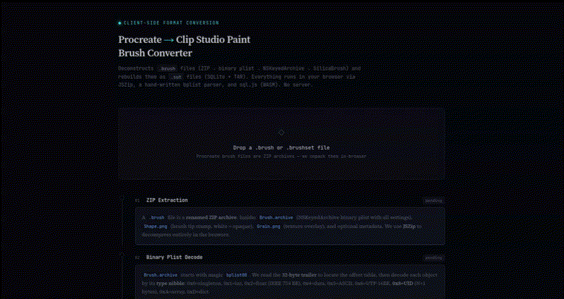

# Brush Converters

Browser tools which currently support conversions between Procreate (`.brush`/`.brushset`) and Clip Studio Paint (`.sut`) brush files. Runs in entirely client-side using WebAssembly.

## Preview

